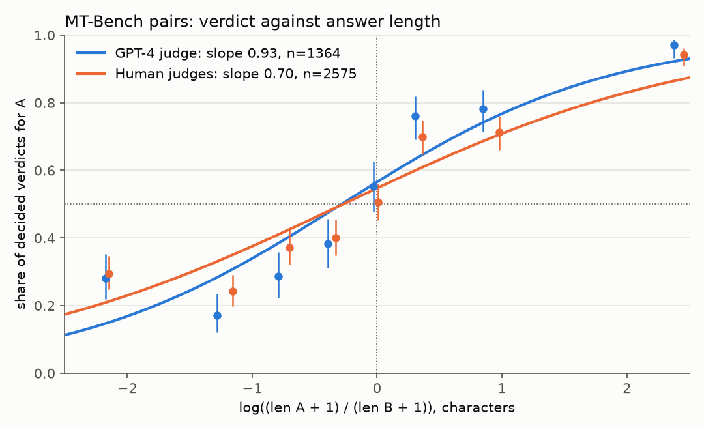

# judgebias

Audit an LLM judge for position bias, length bias, self-preference, repeat consistency and agreement with human labels before trusting its verdicts.

## Why this is hard

A pairwise judge is usually scored on a sample of prompts, each shown in one order, so a judge that prefers whichever answer comes first looks as if it has an opinion about the answers. Length behaves the same way: longer answers win more often with most judges, and without the lengths in hand that reads as quality. Worse, longer answers often are better, so a raw correlation between length and verdict says little until it is compared with what humans do on the same pairs. A judge that is itself a model may favour answers from its own family. Human labels help, but humans disagree with each other too, and their labels contain ties that most agreement figures either drop silently or count as errors. None of this is visible in a single accuracy figure, and on a few hundred prompts a point estimate without an interval is close to meaningless.

## Install

```
pip install git+https://github.com/vipul21435/judgebias
```

Python 3.10 or newer; depends on numpy and scipy. Reading the MT-Bench parquet files needs pyarrow (`pip install "judgebias[mtbench] @ git+https://github.com/vipul21435/judgebias"`). Nothing needs an API key or the network except the optional `run` and `mtbench` commands.

## Quickstart

Each line of the input is one judgment. `verdict` is `A`, `B` or `tie` and names the answer, not the slot it was shown in (numeric labels such as `0` / `1` are refused with an error, since datasets disagree on whether 0 or 1 means A); `order` is `AB` (A shown first, the default) or `BA`. `len_a`, `len_b`, `model_a`, `model_b`, `human`, `repeat` and `flipped` are optional and switch on the measures that need them. A few common key spellings are accepted (`winner` for `verdict`, `question_id` for `pair_id`, `answer_a` text in place of `len_a`, `inconsistent` for `flipped`).

```
{"pair_id": "p00000", "verdict": "A", "order": "AB", "judge": "gamma-70b", "len_a": 451, "len_b": 189, "model_a": "alpha-7b", "model_b": "delta-8x7b", "human": "B", "repeat": 0}
```

`judgebias simulate` writes judgments from a synthetic judge with chosen biases; `judgebias audit` measures them. `examples/synthetic_judge.jsonl` was made with `judgebias simulate examples/synthetic_judge.jsonl --pairs 60 --position 0.6 --length 1.0 --seed 11`:

```
$ judgebias audit examples/synthetic_judge.jsonl
judgments: 120  judges: gamma-70b
position bias
  first-position win rate  0.647 [0.592, 0.706] n=60  (decided 119, ties 1)
  flip rate under swap     0.300 [0.183, 0.417] n=60  (both orders, same judge: 60)
  first-both among flips   0.944 [0.812, 1.000] n=60
length bias
  longer-answer win rate   0.748 [0.664, 0.831] n=60
  logistic slope (log len ratio)  1.739 [1.128, 2.670] n=60
  same, given human label  2.265 [1.536, 3.990] n=60
self-preference (judge family gamma)
  own-family win rate      0.540 [0.393, 0.682] n=60
  same, by human labels    0.467 [0.273, 0.643] n=60
  excess                   +0.073 [-0.062, +0.217] n=60
agreement with humans (ties=keep, labelled 120)
  raw agreement            0.683 [0.583, 0.783] n=60
  Cohen's kappa            0.410 [0.237, 0.581] n=60
```

Brackets are 95 % percentile bootstrap intervals; `n` is the number of prompts resampled. `--json` prints the full report (including the confusion table), `--ties drop` removes tied rows from the agreement measures, and `--reps` and `--seed` control the bootstrap.

From Python (`examples/run_audit.py`):

```
$ uv run python examples/run_audit.py
first-position win rate: 0.723 [0.696, 0.753]
length slope: 1.909 [1.644, 2.206]
kappa vs human labels: 0.317 [0.244, 0.385]
fair judge first-position win rate: 0.500 [0.500, 0.500]
```

The last line is exact rather than lucky: a judge seen in both orders that never flips picks the first slot exactly half the time, so the interval collapses.

### Run mode: judging pairs through an HTTP endpoint

`judgebias run` sends each pair (`pair_id`, `prompt`, `answer_a`, `answer_b`, optional `model_a`, `model_b`, `human`) to any OpenAI-compatible `/chat/completions` endpoint, in both orders by default, and writes judgments ready for `audit`. The bearer token, if any, is read from the environment variable named by `--api-key-env` (default `JUDGE_API_KEY`). Replies that hold no readable verdict (see Limitations) are not turned into ties: the command prints how many there were and leaves them out, and `--unparsed PATH` writes each one with its pair, order and reply text. The judge is pluggable in Python: anything callable as `judge(prompt, first, second) -> "first" | "second" | "tie"` works with `judgebias.judge.run_pairs`.

`examples/stub_judge_server.py` is a local stand-in server that prefers the longer answer and says "first" when the two lengths are within 20 characters. Against the 12 hand-written pairs in `examples/pairs.jsonl`:

```
$ uv run python examples/stub_judge_server.py --port 8765 &
$ judgebias run examples/pairs.jsonl --out judged.jsonl --base-url http://127.0.0.1:8765/v1 --model stub
wrote 24 judgments from 12 pairs to judged.jsonl
$ judgebias audit judged.jsonl
judgments: 24  judges: stub
position bias
  first-position win rate  0.750 [0.583, 0.875] n=12  (decided 24, ties 0)
  flip rate under swap     0.500 [0.167, 0.750] n=12  (both orders, same judge: 12)
  first-both among flips   1.000 [1.000, 1.000] n=12
length bias
  longer-answer win rate   0.800 [0.636, 0.950] n=12
  logistic slope (log len ratio)  1.496 [0.820, 5.421] n=12
  same, given human label  5.084 [3.764, 6.449] n=12
agreement with humans (ties=keep, labelled 24)
  raw agreement            0.458 [0.208, 0.708] n=12
  Cohen's kappa            0.133 [-0.180, 0.440] n=12
```

Every flip is a first-slot flip, which is how the stub was built; with 12 pairs the intervals are wide, as they should be. The tests use a fake transport and never open a connection.

## How it works

Every interval resamples prompts (`pair_id`), not rows, so both presentation orders, repeated samples and several human labels of one pair stay together in each bootstrap draw. Intervals are percentile intervals from 1000 draws by default.

- **Position bias.** `first_win_rate` is the share of decided verdicts that went to the answer shown first; 0.5 is unbiased. `flip_rate` is, over pairs judged in both orders by the same judge, the share whose verdict changed with the order; an AB sample is only ever compared with the BA sample of the same judge and repeat, so a file with several judges that disagree with each other shows no false flips. `audit --judge NAME` keeps one judge's rows (repeat the flag to keep several). `first_both_rate` is, among flipped pairs, the share where the judge took the first slot both times rather than the second. Showing every pair in both orders and calling an order-dependent verdict a tie is the conservative fix described in the MT-Bench paper (Zheng et al., 2023, section 3.4); some datasets publish only that combined verdict, with a flag for the pairs whose two orders disagreed. Rows with `flipped` set are such combined verdicts: they are left out of the three single-order measures and give `combined_flip_rate`, the share flagged.
- **Length bias.** `longer_win_rate` is the share of decided verdicts with unequal lengths that went to the longer answer. `slope` is b in the logistic fit P(A wins) = sigmoid(a + b x) with x = log((len_a + 1) / (len_b + 1)), fitted by L-BFGS on the log-likelihood with an L2 weight of 1e-4 on b, so separable data gives a finite number. b = 0 means length does not move the verdict. Because better answers are often longer, the raw slope mixes a judge's taste for length with real quality. When human labels exist, `slope_given_human` refits with the human label (+1 for A, -1 for B) as a second covariate on rows where neither side tied: what remains is how much length moves the judge beyond what it moves the human. A human label is a noisy measure of quality, so part of that remainder is noise in the covariate; compare it with the same number for one human against another (the `--human-pairs` file below) rather than with zero.
- **Self-preference.** A model's family is its name up to the first `-`, `/`, `_` or `:`. On judgments where exactly one candidate shares the judge's family, `own_win_rate` is how often the judge picked that candidate and `own_win_rate_human` how often the human label did, each over its own decided rows; `excess` is the difference, with an interval in which both rates are recomputed on the same resample. A positive excess means the judge favours its own family beyond what the humans saw on the same pairs, the "self-enhancement" effect discussed in section 3.3 of the MT-Bench paper.
- **Agreement.** Raw agreement and Cohen's kappa, (p_o - p_e) / (1 - p_e) over the full confusion table, between judge and human labels. With `--ties keep`, tie is a third category on both sides (the paper's setup S1, which counts an order-inconsistent verdict as a tie); with `--ties drop`, any row where either side said tie is removed (setup S2). The number of rows each setup keeps is printed, so a high S2 figure on few rows is visible as such.
- **Repeat consistency.** For each (pair, order, judge) with two or more samples told apart by `repeat`, the share of unanimous groups and the share of agreeing sample pairs. Rows that share all four keys are one sample listed several times and count once; different judges are never treated as repeats of each other.
- **Copied rows.** A file that lists one judge verdict once per human label repeats that verdict; the position and length measures, which describe the judge, keep one row per (pair, order, judge, repeat). Agreement and self-preference compare row by row with the human labels and use every row.

## Results on real public data

Data: the MT-Bench human judgments, [lmsys/mt_bench_human_judgments](https://huggingface.co/datasets/lmsys/mt_bench_human_judgments) on Hugging Face, released with the paper [Judging LLM-as-a-Judge with MT-Bench and Chatbot Arena](https://arxiv.org/abs/2306.05685) (Zheng et al., NeurIPS 2023 Datasets and Benchmarks). The dataset card lists the licence as CC BY 4.0 (checked on the dataset page above). It has two splits: `human`, 3,355 verdicts by human judges on pairs of answers from six models to the 80 MT-Bench questions, and `gpt4_pair`, 2,400 verdicts by a GPT-4 judge on every pair (80 questions, 15 model pairs, 2 turns). GPT-4 saw each pair in both orders; a verdict of `tie (inconsistent)` means the two orders disagreed. No data from the set is stored in this repository; `judgebias mtbench` downloads the two parquet files (1.4 MB) into the folder you name.

Commands (each audit takes about 25 seconds with the default 1000 bootstrap draws):

```
judgebias mtbench --data-dir mtb --humans humans.jsonl --judge gpt4.jsonl --human-pairs human_pairs.jsonl
judgebias audit gpt4.jsonl                       # and again with --ties drop
judgebias audit humans.jsonl
judgebias audit human_pairs.jsonl                # and again with --ties drop
judgebias mtbench --data-dir mtb --turn 1 --human-prefix expert --judge t1_gpt4.jsonl --human-pairs t1_human_pairs.jsonl
judgebias audit t1_gpt4.jsonl                    # and the same for t1_human_pairs.jsonl, both tie modes
```

`gpt4.jsonl` holds one row per human verdict, carrying GPT-4's verdict on the same pair; `human_pairs.jsonl` holds one row for every two different human judges who voted on the same pair, one as `verdict` and the other as `human`, which gives the human-human baseline on the same footing.

GPT-4 judge against the human labels (all turns, all human judges; intervals over 1,814 pairs):

| Measure | GPT-4 | One human against another |
|---|---|---|
| Order-inconsistent verdicts (`flipped`) | 0.160 [0.142, 0.176] | n/a |
| Longer-answer win rate | 0.745 [0.720, 0.768] | 0.723 [0.692, 0.754] |
| Length slope, raw | 0.930 [0.784, 1.103] | 0.794 [0.627, 0.975] |
| Length slope, given the other label | 0.717 [0.576, 0.911] | 0.565 [0.428, 0.741] |
| Raw agreement, ties kept (S1) | 0.662 [0.643, 0.682], 3,355 rows | 0.655 [0.627, 0.686], 2,367 rows |
| Cohen's kappa, ties kept | 0.483 [0.455, 0.513] | 0.470 [0.429, 0.513] |
| Raw agreement, ties dropped (S2) | 0.856 [0.837, 0.875], 2,129 rows | 0.827 [0.799, 0.856], 1,550 rows |
| Cohen's kappa, ties dropped | 0.712 [0.673, 0.748] | 0.653 [0.596, 0.710] |

Over all 2,400 GPT-4 verdicts, 380 (0.158) are order-inconsistent, as the `mtbench` command prints. Self-preference: on pairs where exactly one answer comes from a `gpt` model (GPT-4 or GPT-3.5), the GPT-4 judge picked that answer 0.865 [0.835, 0.892] of the time and the human labels on the same rows 0.808 [0.785, 0.831]; the excess is +0.057 [+0.025, +0.088]. The family rule puts GPT-3.5 in the judge's family, so this measures preference for the family, not for GPT-4's own answers alone.



`docs/length_bias.png`, made with `uv run --with matplotlib python examples/plot_length_bias.py gpt4.jsonl humans.jsonl docs/length_bias.png --labels "GPT-4 judge" "Human experts"`: decided verdicts in eight equal-count bins of the log length ratio, with 95 % Wilson intervals and the fitted logistic curves. Both GPT-4 (slope 0.93, 1,364 decided pairs) and the human judges (slope 0.70, 2,575 decided verdicts) favour the longer answer.

Check against the paper. Restricted to first-turn votes by the judges named `expert_N` (the second command above), the row counts and agreement figures match Table 5 of the paper (first turn, G4-Pair against Human, and Human against Human) to the rounding the paper prints:

| | here | paper |
|---|---|---|
| GPT-4 vs human, S1 | 0.660 [0.630, 0.691], 1,343 rows | 66 %, 1,343 votes |
| GPT-4 vs human, S2 | 0.846 [0.817, 0.872], 859 rows | 85 %, 859 votes |
| Human vs human, S1 | 0.630 [0.579, 0.679], 721 rows | 63 %, 721 votes |
| Human vs human, S2 | 0.810 [0.760, 0.853], 479 rows | 81 %, 479 votes |

Human judges, single-order measures (`humans.jsonl`, 3,355 verdicts): first-position win rate 0.502 [0.484, 0.521]; longer-answer win rate 0.694 [0.669, 0.717]; length slope 0.700 [0.593, 0.823]. This takes `model_a` in each row as the answer shown first, which neither the dataset card nor the paper states. No flip rate can be read from this file: a flip compares one judge with itself in both orders, and the file has just one pair that the same human judged in both orders (`both orders, same judge: 1`). Two different people who saw a pair in opposite orders disagree for ordinary reasons; one human against another disagrees on 0.345 of rows (1 - 0.655) whatever the order.

What the numbers say, and no more: on this data GPT-4 agrees with a human as often as two humans agree with each other, or slightly more often, under both tie setups (the intervals overlap). It changes its verdict with the order on about one pair in six. It favours longer answers more than the humans do, but after adjusting for the human label the remaining length pull overlaps with the same figure for one human against another. It picks answers from `gpt` models about six points more often than the humans did, and that interval excludes zero.

## Limitations

- Position and length bias are measured on the judge's verdicts alone. The human-adjusted slope separates a judge's taste for length from quality only as far as the human labels measure quality, and the logistic fits have no other covariates (model identity, question category, turn).
- The MT-Bench GPT-4 split publishes only verdicts that already combine both orders, so its first-position win rate cannot be computed from it; only the share of order-inconsistent verdicts can. The human split's first-position figures assume `model_a` was shown first.
- Self-preference uses a name-prefix family rule, which is wrong for models whose names do not start with their vendor or family, and it cannot tell a judge's taste for its own family from real quality differences that humans missed.
- Intervals are percentile bootstrap intervals over prompts; for very small samples or rates near 0 or 1 they under-cover. No correction for multiple comparisons is applied across the measures.
- The run mode has been tried here against the local stub server only, not against a hosted model. It sends one request per pair, order and repeat with no retries, rate limiting or concurrency, and its reply parser is a set of fixed patterns, not a model: it reads a reply that is only `1`, `2`, `A`, `B`, `first`, `second` or `tie`, an MT-Bench style `[[A]]` / `[[B]]` / `[[C]]` marker, or, in a longer reply, exactly one of `1`, `2`, `first`, `second`, `tie`, `Response A` and the like. A reply that names both slots or none is counted as unparsed and left out, not guessed. A judge that argues at length before naming its pick, or that refers to the answers in some other way, will give many unparsed replies; check the count before reading the audit.
- Lengths are character counts, not tokens.

## Related tools

- [prefpairs](https://github.com/vipul21435/prefpairs): pairwise preference data and Bradley-Terry / Elo ratings, for turning audited verdicts into model rankings.
- [rubricops](https://github.com/vipul21435/rubricops): versioned rubrics and inter-rater agreement for human labels.
- [graderguard](https://github.com/vipul21435/graderguard): audit graders for reward hacking and flakiness.
- [datasieve](https://github.com/vipul21435/datasieve): validate and deduplicate SFT and preference data before it is judged.

## Licence

MIT, see [LICENSE](LICENSE). The MT-Bench data used in the results section is CC BY 4.0 and is not redistributed here.

Built by Vipul Raj Jha · https://vipul21435.github.io
